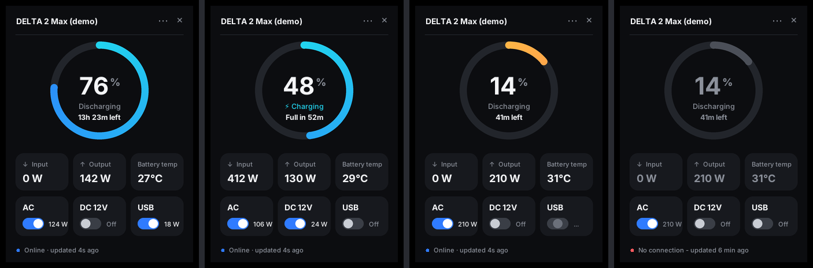

# EcoFlow Desktop Widget

[English version](README.md)

Невеликий віджет поверх усіх вікон і значок у треї для Windows. Показує поточний стан зарядної станції EcoFlow DELTA 2 Max і дозволяє вмикати та вимикати її виходи.

## Можливості

- Кільце заряду батареї у відсотках, стан (заряджається чи розряджається) і час до повного заряду або розряду
- Вхідна та вихідна потужність, температура батареї
- Перемикачі виходів AC, DC 12V і USB з поточною потужністю кожного порту (перед вимкненням AC віджет просить підтвердження)
- Значок у треї з відсотком заряду: колір залежить від рівня, при наведенні видно коротке зведення, а в меню є перемикачі виходів
- Чітко показує, коли дані застаріли або зв'язок втрачено
- Secret Key зберігається в Диспетчері облікових даних Windows, а не у файлі
- Запам'ятовує положення на екрані і може запускатися разом з Windows

## Підтримувані пристрої

Створено й перевірено на **DELTA 2 Max**. Інші моделі EcoFlow передають дані в інших полях, тож частина значень може залишатися порожньою, а перемикачі можуть не працювати.

## Як це працює

Віджет використовує офіційний EcoFlow IoT Developer API, який працює через хмару. Комп'ютер звертається до серверів EcoFlow через інтернет і не підключається до станції напряму в локальній мережі. Тому для оновлень інтернет потрібен і станції (через Wi-Fi), і комп'ютеру.

Поточні значення надходять з потоку даних EcoFlow у реальному часі (MQTT, порт 8883), того самого, що використовує застосунок EcoFlow, тож віджет збігається із застосунком з різницею в кілька секунд. Звичайний запит даних EcoFlow може повертати старий збережений знімок, тому віджет використовує його лише як відправну точку і як запасний варіант, коли потік даних недоступний. Рядок стану завжди показує, що саме ви бачите.

Під час відключення світла віджет показує останні відомі значення з позначкою, скільки хвилин тому вони оновилися, доки роутер та інтернет не запрацюють знову.

## Що потрібно

- Windows 10 або 11
- Python 3.9 або новіший з [python.org](https://www.python.org/downloads/)
- Станція, додана в мобільний застосунок EcoFlow і підключена до Wi-Fi
- Акаунт розробника EcoFlow з Access Key і Secret Key. Див. [Як отримати ключі API](docs/getting-api-keys.uk.md)

## Встановлення

1. **Перевірте Python.** Натисніть Win+R, введіть `cmd`, натисніть Enter і виконайте `py --version`. Підходить версія 3.9 або новіша. Якщо команду не знайдено або відкривається Microsoft Store, встановіть Python з python.org і на першому екрані інсталятора поставте галочку **Add python.exe to PATH**.
2. **Завантажте віджет.** На цій сторінці натисніть зелену кнопку **Code**, потім **Download ZIP**, або завантажте ZIP з розділу **Releases**. Розпакуйте його в постійну папку, наприклад `C:\Tools\ecoflow-widget`. Не запускайте віджет з папки "Завантаження", бо ярлик автозапуску посилатиметься саме на цю папку.
3. Двічі клацніть `install.bat`.
4. Двічі клацніть `start.bat`. Відкриється вікно налаштувань. Вставте Access Key і Secret Key, натисніть **Connect**, виберіть свою станцію і натисніть **Save**. Якщо станції немає у списку, введіть її серійний номер у поле **Device** і натисніть **Save**.
5. Необов'язково: двічі клацніть `add_to_startup.bat`, щоб віджет запускався разом з Windows.

**Спробувати без ключів:** відкрийте папку віджета, клацніть в адресний рядок Провідника, введіть `cmd`, натисніть Enter і виконайте `start.bat --demo`.

Під час першого запуску `install.bat` Windows може показати попередження безпеки, бо файл завантажено з інтернету. Натисніть **Запустити** (Run) або **Докладніше** (More info), а потім **Усе одно запустити** (Run anyway). Скрипти не мають цифрового підпису, і це нормально для невеликих програм з відкритим кодом. Після цього віджет сам знімає цю позначку зі своїх файлів, а ярлик автозапуску запускає Python напряму, тож під час запуску Windows попередження більше не з'являтиметься.

## Користування

Інтерфейс віджета англійською, тому нижче назви кнопок і пунктів меню наведено так, як вони виглядають у програмі.

- **Перетягуйте** панель куди завгодно. Положення запам'ятовується.
- **Клацніть плитку AC, DC 12V або USB**, щоб увімкнути чи вимкнути цей вихід. Синій перемикач означає "увімкнено", а число поруч показує, скільки ват цей порт споживає зараз. Для USB це сума всіх портів USB-A і USB-C. Перед вимкненням AC віджет попросить підтвердження, бо це знеструмить усе, що підключено до розеток станції.
- **Кільце** синє, коли заряд вище 20%, стає оранжево-червоним при 20% і нижче та сірим, коли дані застаріли.
- **Права кнопка миші** на панелі або `...` відкриває меню: Refresh now (оновити), Settings (налаштування), Open data folder (папка з даними), Quit (вийти). Кнопка `x` ховає панель у трей.
- **Значок у треї** показує відсоток заряду. Він синій у звичайному стані, червоний при 20% і нижче та сірий, коли дані застаріли. Біла смужка під числом означає, що станція заряджається. Ліва кнопка показує або ховає панель, права відкриває меню з перемикачами виходів. Наведіть курсор, щоб побачити коротке зведення.
- Щоб значок завжди було видно на панелі завдань: Параметри > Персоналізація > Панель завдань > розділ з іншими значками трею (Other system tray icons), там увімкніть віджет.

## Рядок стану

| Текст | Що означає |
|---|---|
| `Live · updated 3s ago` | Усе працює, значення в реальному часі |
| `Live data paused · last 4 min ago` | Потік даних затих. Значення показано сірим |
| `No live feed · snapshot 5s ago` | Потік даних не підключається, тому віджет показує знімок від EcoFlow, який може бути застарілим. Див. [Вирішення проблем](docs/troubleshooting.uk.md) |
| `Snapshot mode - run install.bat` | Бракує бібліотеки для потоку даних. Запустіть `install.bat` |
| `No connection` | Комп'ютер не може зв'язатися з EcoFlow. Показано останні відомі значення сірим |
| `Device offline in EcoFlow cloud` | Станція вимкнена або не підключена до Wi-Fi |
| `Keys rejected` | Перевірте ключі в налаштуваннях |

## Оновлення

Завантажте новий ZIP і замініть файли у своїй папці. Залиште ту саму папку, щоб ярлик автозапуску продовжував працювати. Один раз запустіть `start.bat` вручну: Windows може запитати востаннє, а потім віджет сам зніме попередження з нових файлів. Якщо змінився `requirements.txt`, ще раз запустіть `install.bat` (для v1.2.0 це потрібно один раз, через потік даних у реальному часі). Налаштування та ключі збережуться.

Оновлюєтеся з v1.0.0 або v1.1.0? Ще раз запустіть `add_to_startup.bat`. Він замінить старий ярлик автозапуску на такий, що ніколи не викликає попередження безпеки.

## Видалення

1. Закрийте віджет через меню в треї (Quit).
2. Натисніть Win+R, введіть `shell:startup` і видаліть ярлик "EcoFlow Widget", якщо ви його додавали.
3. Видаліть папку віджета.
4. Видаліть папку `%APPDATA%\EcoFlowWidget` (вставте цей шлях в адресний рядок Провідника).
5. Відкрийте Диспетчер облікових даних > Облікові дані Windows і видаліть запис, у назві якого є "EcoFlowWidget".

## Конфіденційність і безпека

- Віджет звертається лише до серверів API EcoFlow. Жодної телеметрії.
- Secret Key ніколи не залишає ваш комп'ютер. Він використовується лише для підпису запитів.
- Налаштування зберігаються в `%APPDATA%\EcoFlowWidget`: `config.json` (Access Key, серійний номер, налаштування), `last_data.json` (останні отримані дані) і `widget.log`. Не публікуйте ці файли.

## Вирішення проблем

Див. [Вирішення проблем](docs/troubleshooting.uk.md).

## Застереження

Це незалежний проєкт, який не пов'язаний з EcoFlow і не схвалений компанією. "EcoFlow" і "DELTA" є торговими марками їхніх власників. Віддалене керування виходами ви використовуєте на власний ризик. EcoFlow може будь-коли змінити свій API, і тоді віджет може перестати працювати.

## Подяки

Назви полів даних і формати команд для DELTA 2 Max взято з напрацювань інтеграції для Home Assistant [hassio-ecoflow-cloud](https://github.com/tolwi/hassio-ecoflow-cloud).

## Ліцензія

[MIT](LICENSE) (текст ліцензії англійською, як це прийнято для юридично чинної версії)
